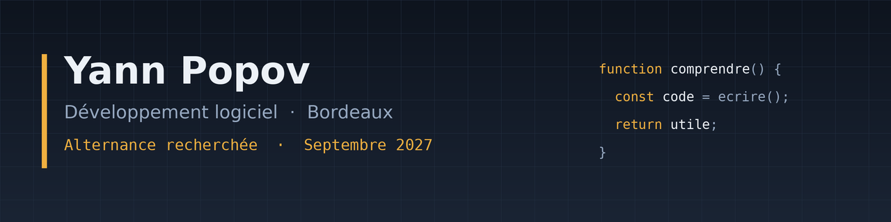

## À propos

Étudiant en BTS SIO option SLAM à l'EPSI Bordeaux, je me forme au développement logiciel et je cherche une alternance en développement backend et logiciel à Bordeaux à partir de septembre 2027.

Je n'aime pas utiliser du code que je ne comprends pas : je veux savoir pourquoi ça marche, au point de pouvoir le réécrire seul. J'aime aussi concevoir des outils qui me sont utiles au quotidien, et mon projet professionnel s'oriente vers le développement logiciel.

## En quelques lignes

```console
yann@bordeaux:~$ whoami
Yann Popov

yann@bordeaux:~$ cat profil.txt
formation      BTS SIO SLAM, EPSI Bordeaux
ville          Bordeaux
objectif       Alternance en développement logiciel
disponibilité  Septembre 2027
approche       Comprendre chaque ligne avant de l'écrire
j'apprends     bases de données, algorithmique, systèmes
```

## Technologies


## Outils


## Me contacter

[](https://www.linkedin.com/in/yannpopov/)
[](mailto:yann.popov@hotmail.fr)
